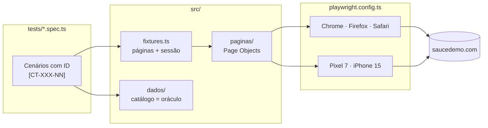
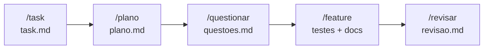

<div align="center">

# 🎭 QA Lab — E2E com Playwright

**Automação de testes ponta a ponta de uma loja virtual (Sauce Demo), em 3 navegadores e 2 celulares,
com Page Objects, acessibilidade, defeitos reais documentados e CI no GitHub Actions.**

[](https://github.com/QApedroHenrique/qa-lab-e2e-playwright/actions/workflows/e2e.yml)


[**👋 Apresentação**](#-apresentação-sem-termos-técnicos) ·
[**📊 Relatório de testes**](https://QApedroHenrique.github.io/qa-lab-e2e-playwright/) ·
[**🐞 Defeitos encontrados**](docs/relatorio-de-defeitos.md) ·
[**🔎 Estudo de QA manual**](docs/qa-manual/README.md) ·
[**▶️ Como rodar**](#️-como-rodar)

</div>

---

## 👋 Apresentação (sem termos técnicos)

> Antes de uma loja virtual ir ao ar, alguém precisa garantir que dá para entrar, escolher produtos, pagar
> e receber a confirmação, **no computador e no celular**. Fazer isso à mão a cada mudança é lento e falha.

Este projeto é um **robô que usa a loja como um cliente de verdade**: abre o site, faz login, coloca produtos no
carrinho, preenche os dados e finaliza a compra, conferindo cada detalhe pelo caminho. Ele faz isso em
**Chrome, Firefox e Safari** e em **dois celulares** (Android e iPhone), totalizando **293 verificações** a cada execução.

- 🛒 **O cliente consegue comprar?** O fluxo inteiro, do login à confirmação do pedido.
- 🧾 **A conta fecha?** Subtotal, imposto de 8% e total conferidos centavo por centavo.
- 📱 **Funciona no celular?** A página cabe na tela e tudo funciona com o toque.
- ♿ **Pessoas com deficiência conseguem usar?** Verificação automática de acessibilidade e login só com teclado.

**E o mais importante para um QA: ele acha defeitos.** Foram encontrados e documentados **12 defeitos** no site,
incluindo **4 que afetam qualquer usuário** (como conseguir "concluir" um pedido com o carrinho vazio). Cada defeito tem
passo a passo para reproduzir e um teste que avisa se ele for corrigido. Veja o
[**relatório de defeitos**](docs/relatorio-de-defeitos.md).

**Para conferir em 1 minuto:** o selo verde ✅ acima mostra a última execução, e o
[**relatório de testes**](https://QApedroHenrique.github.io/qa-lab-e2e-playwright/) mostra cada teste com
passo a passo, sem instalar nada.

> 🔒 O site testado é o [Sauce Demo](https://www.saucedemo.com), uma loja **pública e fictícia** feita pela Sauce Labs
> para treino de automação. Nenhum dado real é usado.

---

## 🔎 Além do robô: estudo de caso de QA manual

O robô confirma o que foi previsto. Para achar o que **ninguém previu**, a mesma loja passou por um ciclo de QA
manual: **plano de teste**, **5 sessões exploratórias**, **38 casos roteirizados**, **comparação visual contra uma
referência** (como um FQA contra o Figma) e **checklist de acessibilidade WCAG 2.2**.

Resultado: **13 defeitos novos**, com a suíte automatizada inteira verde. Dois deles **impedem a compra**: quem usa
só teclado não chega ao carrinho, e o checkout aceita nome e CEP preenchidos só com espaços. Cada bug tem passo a
passo, evidência anotada, impacto e a decisão justificada de virar ou não teste automatizado.

👉 [**Ler o estudo de caso**](docs/qa-manual/README.md) · [Plano](docs/qa-manual/plano-de-teste.md) ·
[Bugs](docs/qa-manual/bugs/) · [Checklist](docs/qa-manual/checklist.md)

---

## 🎯 O que é testado

| Área | Casos | Destaques |
|---|---:|---|
| Login | 7 | Tabela de decisão com 6 combinações inválidas, usuário bloqueado, acesso sem sessão, login só com teclado |
| Lista de produtos | 6 | Preços conferidos com o catálogo, 4 ordenações, contador do carrinho |
| Detalhe do produto | 3 | Os 6 produtos conferidos contra a lista |
| Carrinho | 5 | Remoção, persistência ao recarregar, continuar comprando |
| Checkout | 6 | Fluxo completo, campos obrigatórios, **imposto e total em centavos** com 1, 3 e 6 itens |
| Menu e navegação | 5 | Logout encerra a sessão de verdade, reset, links |
| Mobile | 5 | Sem rolagem horizontal, uma coluna, menu e compra **por toque** |
| Acessibilidade | 3 | WCAG 2.1 A/AA com axe-core nas 7 telas |
| Defeitos conhecidos | 11 | Comportamento correto com `test.fail`: monitora cada bug a cada execução |
| **Total** | **51 casos** | **293 execuções** nos 5 projetos |

Catálogo completo com técnica ISTQB e prioridade: [**docs/casos-de-teste.md**](docs/casos-de-teste.md).

---

## ✨ Destaques técnicos

<details>
<summary><b>Page Objects + fixtures: testes que leem como um roteiro</b></summary>

Cada tela tem uma classe em [`src/paginas/`](src/paginas) e o cabeçalho é um componente reaproveitado.
As fixtures injetam as páginas já prontas e abrem a sessão pelo cookie do site, então o teste fica só com o que importa:

```ts
test('[CT-CHK-01] compra completa ...', async ({ inventario, carrinho, checkoutDados, checkoutResumo }) => {
  await inventario.abrir();
  await inventario.adicionar(PRODUTOS.mochila, PRODUTOS.lanterna);
  await inventario.cabecalho.abrirCarrinho();
  await carrinho.finalizarCompra();
  await checkoutDados.continuarCom(CLIENTE_VALIDO);
  ...
```
</details>

<details>
<summary><b>Defeitos como testes vivos (<code>test.fail</code>)</b></summary>

Cada defeito vira um teste do comportamento **correto**, marcado com `test.fail`. Enquanto o bug existir, a suíte
fica verde; se alguém corrigir, o teste "passa inesperadamente" e o CI avisa que o relatório precisa ser atualizado.
Um script no CI garante que todo `BUG-NN` citado nos testes está no [relatório de defeitos](docs/relatorio-de-defeitos.md) e vice-versa.
</details>

<details>
<summary><b>Estabilidade investigada, não escondida</b></summary>

No WebKit (Safari), o site às vezes perdia o texto digitado e cliques logo após a página aparecer, e trocava a URL
antes de trocar a tela. Em vez de aumentar tempos de espera, cada causa foi isolada: os Page Objects esperam um
elemento **exclusivo da página de destino** e `preencherCampo` confirma que o valor ficou no campo. Espera fixa
(`waitForTimeout`) é proibida pelo ESLint. Quando o CI marcou o menu como *instável* (passava só na 2ª tentativa),
o trace mostrou uma corrida no próprio site: virou o [BUG-12](docs/relatorio-de-defeitos.md#bug-12--menu-reaberto-logo-após-fechar-fica-aberto-porém-invisível)
em vez de um "retry" escondendo o problema. O processo está registrado em
[`.claude/tasks/suite-e2e-saucedemo/questoes.md`](.claude/tasks/suite-e2e-saucedemo/questoes.md).
</details>

<details>
<summary><b>Oráculos independentes</b></summary>

O valor esperado nunca é copiado da própria tela: preços vêm do catálogo em [`src/dados/produtos.ts`](src/dados/produtos.ts),
o imposto é recalculado em centavos e o total de todos os produtos é conferido com um valor escrito à mão ($140.34).
A ordenação é comparada com a lista ordenada **e** com o catálogo, para pegar produto sumido ou duplicado.
</details>

<details>
<summary><b>CI em paralelo, com relatório único publicado</b></summary>

O GitHub Actions roda lint, tipos e rastreabilidade; depois os 5 projetos **em paralelo** (um job por navegador/dispositivo);
por fim junta tudo num relatório HTML com trace, vídeo e screenshot das falhas, publicado no GitHub Pages.
Também roda **todo dia**, porque o site é público e pode mudar sem aviso.
</details>

---

## 🏗️ Arquitetura



```
├── src/
│   ├── paginas/            # Page Objects (Login, Inventario, Produto, Carrinho, Checkout*) + componentes/Cabecalho
│   ├── suporte/            # fixtures, ações robustas, conversão de preço para centavos
│   └── dados/              # usuários, catálogo de produtos, clientes e mensagens do site
├── tests/                  # um spec por funcionalidade + mobile, acessibilidade e defeitos conhecidos
├── docs/                   # casos de teste e relatório de defeitos
│   └── qa-manual/          # estudo de QA manual: plano, sessões, casos, bugs com evidência, checklist
├── scripts/                # rastreabilidade e resumo da execução no CI
├── .github/workflows/      # pipeline (qualidade → 5 projetos em paralelo → relatório → Pages)
└── .claude/                # fluxo com IA: skills e artefatos das tarefas
```

---

## ▶️ Como rodar

Pré-requisito: **Node.js 20+**.

```bash
npm ci
npx playwright install --with-deps   # baixa Chromium, Firefox e WebKit
npm test                             # 293 execuções nos 5 projetos
```

| Comando | O que faz |
|---|---|
| `npm run test:chromium` | Só Chrome desktop (mais rápido) |
| `npm run test:mobile` | Só Pixel 7 e iPhone 15 |
| `npm run test:smoke` | Caminho crítico (`@smoke`) |
| `npm run test:ui` | Modo interativo do Playwright |
| `npm run relatorio` | Abre o último relatório HTML |
| `npm run lint` · `npm run typecheck` · `npm run docs:verificar` | Qualidade e rastreabilidade |

---

## 🤖 Desenvolvimento assistido por IA (Claude Code)

As mudanças passam por **skills em camadas** ([`.claude/skills/`](.claude/skills)), cada uma com um papel:



O `/questionar` faz o papel de QA cético e **não concorda por padrão**: nesta suíte ele apontou um falso positivo na
ordenação, a causa da instabilidade no WebKit e um teste de defeito que podia passar sem o bug ter sido corrigido, todos resolvidos.
Um teste marcado como *instável* no CI virou investigação de trace e revelou um defeito intermitente do menu (BUG-12).
Exemplo completo em [`.claude/tasks/suite-e2e-saucedemo/`](.claude/tasks/suite-e2e-saucedemo). O [`CLAUDE.md`](CLAUDE.md)
guarda as regras fixas do projeto.

---

## 🛠️ Stack

**Playwright Test** · **TypeScript** (strict) · **@axe-core/playwright** · **ESLint** (typescript-eslint + eslint-plugin-playwright) ·
**GitHub Actions** (matriz + merge de relatórios) · **GitHub Pages**

Outro projeto do portfólio: [**QA Lab — API de Pagamentos**](https://github.com/QApedroHenrique/qa-lab-api-pagamentos)
(testes de API, contrato, webhooks, concorrência e SQL).

---

## 👤 Autor

**Pedro Henrique Barbosa dos Santos** — QA

[](https://www.linkedin.com/in/pedro-henrique-996aa7355/)

Distribuído sob a licença [MIT](LICENSE).
