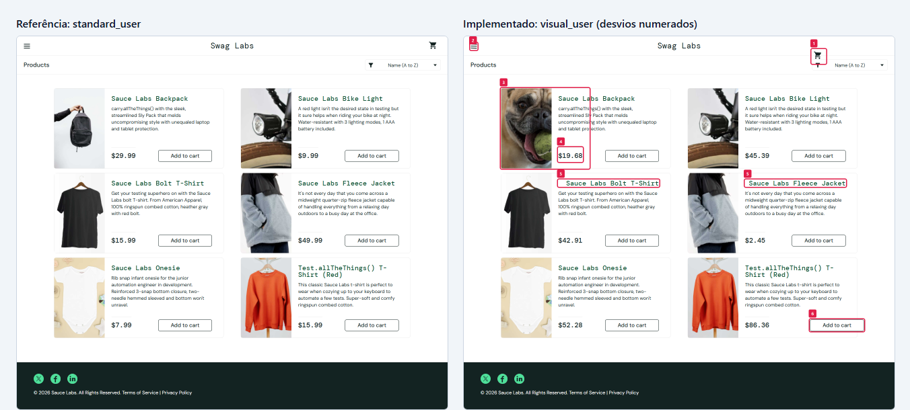

# 🔎 Estudo de caso — QA manual do Sauce Demo

> **Em uma frase:** a [suíte automatizada](../../README.md) confirma a cada execução que a loja continua fazendo o que
> foi previsto. Este estudo procura **o que ninguém previu**, e achou **13 defeitos novos**. Dois deles
> **impedem a compra** e passavam com a suíte inteira verde.

| | |
|---|---|
| **Sistema** | [Sauce Demo](https://www.saucedemo.com), loja pública de treino |
| **Data** | 2026-11-27 |
| **Abordagem** | Plano de teste · 5 sessões exploratórias · 38 casos roteirizados · FQA visual contra referência · checklist WCAG 2.2 |
| **Resultado** | 13 bugs (🔴 2 · 🟡 6 · 🟢 5) · 7 observações para o produto · 2 hipóteses descartadas |

---

## Por que teste manual se já existe automação?
Teste automatizado só verifica o que alguém pensou em verificar. Esta loja tem 51 casos automatizados rodando em 5
navegadores, axe-core em todas as telas e CI todo dia, e mesmo assim:

- **quem usa só teclado não consegue comprar**: o carrinho não recebe foco ([BUG-13](bugs/BUG-13.md));
- **um pedido pode ser feito sem nome e sem CEP**, digitando espaços ([BUG-14](bugs/BUG-14.md));
- **duas funcionalidades inteiras** (o "Dynamic Catalog" e o recibo em PDF) apareceram no site sem nenhum teste.

Nenhum desses achados exige ferramenta especial. Exige alguém olhando o site com outra pergunta na cabeça.

## O "Figma" deste projeto
Num FQA de verdade, a tela implementada é comparada com o design aprovado. O Sauce Demo não tem design público,
então o estudo definiu **oráculos** antes de começar ([plano, seção 5](plano-de-teste.md#5-oráculos-como-saber-o-que-é-certo-sem-especificação)):

- a tela do **`standard_user` faz o papel do design aprovado**, e a do `visual_user` é a implementação a validar;
- o **WCAG 2.2 AA** é a régua de acessibilidade, citada pelo número em cada bug;
- a **consistência do próprio site** ("$0" numa linha e "$0.00" na de baixo é defeito, com ou sem especificação).

O resultado da comparação visual está no [BUG-20](bugs/BUG-20.md): 7 desvios numerados sobre a tela, lado a lado com a referência.

---

## Defeitos encontrados

| ID | Resumo | Sev. | Prior. | Área | Vira automação? |
|---|---|---|---|---|---|
| [BUG-13](bugs/BUG-13.md) | Ícone do carrinho não pode ser acessado pelo teclado | 🔴 | P1 | Acessibilidade | ✅ Candidato |
| [BUG-14](bugs/BUG-14.md) | Checkout aceita nome, sobrenome e CEP só com espaços | 🔴 | P1 | Checkout | ✅ Candidato |
| [BUG-15](bugs/BUG-15.md) | Checkout não valida formato nem tamanho do nome e do CEP | 🟡 | P2 | Checkout | ✅ Depois de definir a regra |
| [BUG-16](bugs/BUG-16.md) | Não aparece indicação de foco ao navegar pelo teclado | 🟡 | P2 | Acessibilidade | ⚠️ Manual (julgamento visual) |
| [BUG-17](bugs/BUG-17.md) | Slider troca a cada 2 s e não pode ser pausado | 🟡 | P2 | Dynamic Catalog | ❌ Manual (depende de tempo) |
| [BUG-18](bugs/BUG-18.md) | Lazy Load lista o tamanho L duas vezes e repete o catálogo sem fim | 🟡 | P3 | Dynamic Catalog | ✅ Candidato |
| [BUG-19](bugs/BUG-19.md) | "Voltar" depois da compra mostra resumo zerado com "$0" e Finish ativo | 🟢 | P3 | Checkout | ✅ Candidato |
| [BUG-20](bugs/BUG-20.md) | Layout do `visual_user` diverge da referência em 7 pontos | 🟡 | P2 | Visual | ⚠️ Manual (comparação visual) |
| [BUG-21](bugs/BUG-21.md) | Campos do checkout só com placeholder e sem `autocomplete` | 🟡 | P2 | Acessibilidade | ✅ Candidato (`autocomplete`) |
| [BUG-22](bugs/BUG-22.md) | Mesmo título em todas as páginas e nenhum `h1` | 🟢 | P3 | Acessibilidade | ✅ Candidato |
| [BUG-23](bugs/BUG-23.md) | Botão do menu e pontos do slider pequenos demais para o toque | 🟢 | P3 | Mobile | ✅ Candidato |
| [BUG-24](bugs/BUG-24.md) | Páginas internas respondem HTTP 404; URL inexistente mostra tela branca | 🟢 | P3 | Técnico | ⚠️ Fora do E2E (monitoramento) |
| [BUG-25](bugs/BUG-25.md) | Recibo em PDF sem número do pedido e com hora diferente do nome do arquivo | 🟢 | P3 | Recibo | ❌ Manual (documento + fuso) |

A numeração continua a dos [12 defeitos achados pela automação](../relatorio-de-defeitos.md), para o projeto ter uma
lista única. **12 dos 13 acontecem com o `standard_user`**, o usuário que deveria funcionar (só o BUG-20 é de um
usuário quebrado de propósito).

### Severidade não é prioridade
Cada bug tem as duas. O BUG-18 é 🟡 (o cliente vê produto duplicado), mas P3 (área de demonstração, sem compra).
O BUG-13 é 🔴 e P1, porque tira a compra de um grupo inteiro de usuários.

---

## O que a automação não pegou e por quê
Esta é a parte que mais interessa para quem mantém a suíte: o motivo de cada achado ter passado.

| Motivo | Bugs | O que fazer |
|---|---|---|
| **Funcionalidade nova sem teste** | BUG-17, BUG-18, BUG-25 | Exploração a cada entrega (checklist, item 1.7) |
| **O axe-core não verifica isso** (teclado, foco, placeholder como rótulo, movimento) | BUG-13, BUG-16, BUG-17, BUG-21 | Checklist manual de acessibilidade, [seção 5](checklist.md#5-acessibilidade-wcag-22-aa-o-que-exige-uma-pessoa) |
| **Partição de dados não testada** (entre "vazio" e "válido") | BUG-14, BUG-15 | Novas entradas nos testes orientados a dados |
| **Visual fora do escopo da automação** | BUG-20 | FQA manual a cada mudança de layout |
| **Camada errada** (status HTTP não aparece na tela) | BUG-24 | Monitor de disponibilidade ou teste de API |

**Decisão de automação:** 8 bugs são candidatos a teste automatizado (no padrão do projeto: teste do
comportamento correto com `test.fail`); 5 continuam manuais, cada um com o motivo registrado no próprio bug.
Automatizar um defeito que depende de tempo (BUG-17) iria contra a regra do projeto: teste que falha ao acaso
destrói a confiança na suíte.

---

## Recomendação
**Se fosse uma entrega real: não liberar sem corrigir BUG-13 e BUG-14.** Os dois têm correção pequena (um `href`
e um `trim`), e sem eles uma parte dos clientes não compra, ou compra sem endereço de entrega.
Os 🟡 vão para a próxima entrega; os 🟢 para o backlog. As 7 observações vão para o produto como perguntas.

---

## Rigor: o que foi descartado
Dois "bugs" pareciam reais e **não foram registrados**, porque a verificação mostrou que não eram:

1. **"A mensagem de erro não é anunciada por leitor de tela."** O contêiner não tinha `role`, mas o elemento de
   dentro tem `role="alert"`.
2. **"O slider mostra a foto de um produto com o nome de outro."** Era o print tirado no meio da animação.

Bug falso custa caro: o desenvolvedor investiga, não reproduz e passa a desconfiar dos próximos reports. Os dois
casos estão nas [sessões S2 e S3](sessoes-exploratorias.md) e nas [questões da tarefa](../../.claude/tasks/estudo-qa-manual/questoes.md).

---

## Documentos
| Documento | Para quê |
|---|---|
| [Plano de teste](plano-de-teste.md) | Escopo, riscos, abordagem, oráculos, critérios de entrada e saída, severidade × prioridade |
| [Sessões exploratórias](sessoes-exploratorias.md) | 5 charters com notas, incluindo desvios da missão e hipóteses descartadas |
| [Casos de teste manuais](casos-de-teste.md) | 38 casos (CTM-) com status e decisão de automação, mais 7 observações |
| [Bug reports](bugs/) | 13 reports com passos, esperado × obtido, evidência, impacto e análise técnica |
| [Checklist](checklist.md) | Reaproveitável, preenchido com esta rodada |
| [Evidências](evidencias/) | Prints anotados e recibos em PDF |

## Ambiente e limitações
Chromium, Firefox e WebKit (versões do Playwright 1.65), desktop 1280×720; Pixel 7 e iPhone 15 emulados; DevTools,
`curl` e leitor de PDF. As evidências foram capturadas num navegador controlado por script, para que os prints
ficassem reproduzíveis e com as marcações na posição exata dos elementos. A investigação, os critérios e os relatórios
são manuais. **Não foram usados** leitores de tela reais nem aparelhos físicos: ficam como próximos passos no
[checklist](checklist.md).
