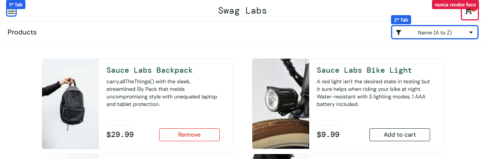

# BUG-13 — Ícone do carrinho não pode ser acessado pelo teclado

| Campo | Valor |
|---|---|
| **Severidade** | 🔴 Alta: impede a compra para quem navega só pelo teclado |
| **Prioridade** | P1 |
| **Tipo** | Acessibilidade · WCAG 2.2 **2.1.1 Teclado (nível A)** |
| **Usuário** | `standard_user` (qualquer usuário) |
| **Ambiente** | Chromium, Firefox e WebKit (Playwright 1.65), desktop 1280×720 · 2026-11-27 |
| **Reprodutibilidade** | Sempre: 3 de 3 navegadores |
| **Caso / sessão** | [CTM-CAR-01](../casos-de-teste.md#carrinho) · [Sessão S2](../sessoes-exploratorias.md#s2--navegação-só-com-teclado) |

## Passos para reproduzir
1. Entrar com `standard_user` / `secret_sauce`.
2. Adicionar qualquer produto (o contador do carrinho mostra **1**).
3. Clicar numa área vazia da página e apertar **Tab** repetidamente desde o topo.

## Resultado esperado
O ícone do carrinho recebe o foco (ele aparece no topo, entre o menu e a ordenação) e **Enter** abre o carrinho.

## Resultado obtido
A ordem do Tab é: menu (1º) → ordenação (2º) → produtos. O carrinho **nunca recebe foco**, em nenhum dos três
navegadores. O ícone é o único caminho para o carrinho na interface, então só quem usa mouse ou toque consegue
finalizar a compra.

## Impacto
Quem usa só teclado (deficiência motora, leitor de tela, usuário avançado) **não consegue comprar**. O leitor de
tela ainda anuncia o link como "Cart, 1 items", o que confunde: o elemento existe na leitura, mas não pode ser ativado.

## Análise técnica
O elemento é `<a class="shopping_cart_link" data-test="shopping-cart-link" aria-label="Cart, 1 items">` **sem
`href`**. A navegação acontece por um `onClick` em JavaScript. Um `<a>` sem `href` não entra na ordem de foco.
**Correção sugerida:** `href="/cart.html"` (ou trocar por `<button>`).

## Por que a automação não pegou
O axe-core (CT-ACS-01) não tem regra para "link sem `href` com clique em JavaScript", e o teste de teclado
existente (CT-LOG-07) cobre só o login.

## Automação
✅ **Candidato.** É determinístico: um teste que aperta Tab até sair do cabeçalho e confere se o carrinho recebeu
foco, marcado com `test.fail` enquanto o defeito existir.
