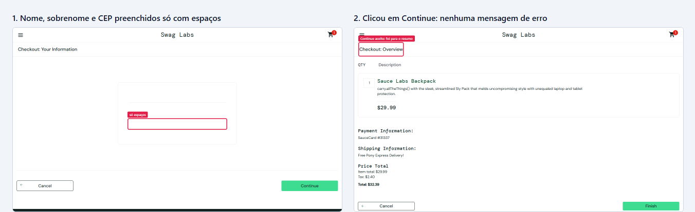

# BUG-14 — Checkout aceita nome, sobrenome e CEP preenchidos só com espaços

| Campo | Valor |
|---|---|
| **Severidade** | 🔴 Alta: burla a validação de campos obrigatórios; o pedido sai sem destinatário |
| **Prioridade** | P1 |
| **Tipo** | Funcional · validação de formulário |
| **Usuário** | `standard_user` |
| **Ambiente** | Chromium (Playwright 1.65), desktop 1280×720 · 2026-11-27 |
| **Reprodutibilidade** | Sempre (3 de 3 tentativas) |
| **Caso / sessão** | [CTM-CHK-01](../casos-de-teste.md#checkout) · [Sessão S1](../sessoes-exploratorias.md#s1--checkout-com-dados-no-limite) |
| **Relacionado** | [BUG-05](../../relatorio-de-defeitos.md#bug-05--checkout-avança-sem-o-sobrenome-obrigatório) (mesma regra, mas lá só com o `error_user`) |

## Passos para reproduzir
1. Entrar com `standard_user` e adicionar "Sauce Labs Backpack" ao carrinho.
2. Carrinho → **Checkout**.
3. Digitar **três espaços** em First Name, Last Name e Zip/Postal Code.
4. Clicar em **Continue** → **Finish** → **Generate PDF order**.

## Resultado esperado
A mesma mensagem de campo vazio, "Error: First Name is required", porque um valor só com espaços não é um nome.

## Resultado obtido
O checkout avança para o resumo sem nenhuma mensagem, o pedido é concluído e o **recibo sai com o campo
"SHIP TO" em branco**.

Recibo gerado: [bug-14-recibo.pdf](../evidencias/bug-14-recibo.pdf) (seção "SHIP TO" vazia).

## Impacto
O pedido é registrado sem nome e sem CEP, então não tem como ser entregue. A validação existe para impedir
justamente isso, e um espaço (inclusive digitado sem querer, ou colado) passa por ela.

## Análise técnica
A validação confere `valor !== ''`, sem remover os espaços (`trim`) antes. **Correção sugerida:** validar
`valor.trim()` e gravar o valor já sem espaços nas pontas.

## Automação
✅ **Candidato.** Determinístico e barato: um teste orientado a dados no CT-CHK-03, com a entrada `"   "` em cada
campo, marcado com `test.fail`.
