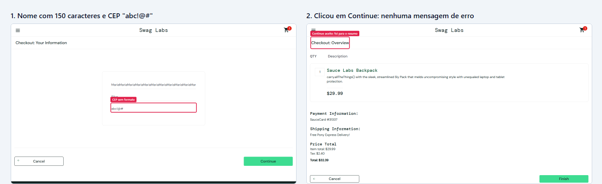

# BUG-15 — Checkout não valida formato nem tamanho do nome e do CEP

| Campo | Valor |
|---|---|
| **Severidade** | 🟡 Média: dado inválido chega ao pedido e ao recibo |
| **Prioridade** | P2 |
| **Tipo** | Funcional · validação de formulário |
| **Usuário** | `standard_user` |
| **Ambiente** | Chromium (Playwright 1.65), desktop 1280×720 · 2026-11-27 |
| **Reprodutibilidade** | Sempre |
| **Caso / sessão** | [CTM-CHK-02 e CTM-CHK-03](../casos-de-teste.md#checkout) · [Sessão S1](../sessoes-exploratorias.md#s1--checkout-com-dados-no-limite) |

## Passos para reproduzir
1. Entrar com `standard_user`, adicionar um produto e ir ao **Checkout**.
2. First Name: `Maria` repetido 30 vezes (150 caracteres). Last Name: `Silva`. Zip/Postal Code: `abc!@#`.
3. **Continue** → **Finish** → **Generate PDF order**.

| Entrada (técnica) | Esperado | Obtido |
|---|---|---|
| CEP `abc!@#` (classe inválida: letras e símbolos) | Mensagem de CEP inválido | Aceito |
| Nome com 150 caracteres (acima de um limite razoável) | Limite no campo ou mensagem | Aceito, sem limite (`maxlength` ausente) |
| Nome `<b>x</b>` (marcação HTML) | Exibido como texto | Exibido como texto ✅ (não interpretado) |

## Resultado obtido
Os três casos avançam para o resumo. O recibo mostra o CEP `abc!@#` e o nome longo quebrado em duas linhas.

Recibo gerado: [bug-15-recibo.pdf](../evidencias/bug-15-recibo.pdf).

## Impacto
Endereço impossível de usar na entrega, e um campo sem limite permite enviar textos enormes para o backend.

## Observação para o time
O site não diz de que país é o CEP, então o formato exato é decisão de produto. O mínimo esperado é rejeitar
símbolos e limitar o tamanho; o formato exato (5 dígitos nos EUA, `00000-000` no Brasil) precisa de regra definida.

## Automação
✅ **Candidato**, depois que o produto definir a regra do CEP. Sem a regra, o teste não teria oráculo.
