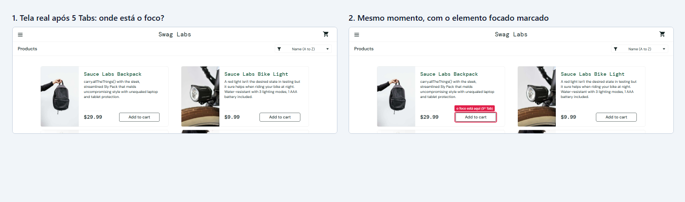

# BUG-16 — Não aparece indicação de foco ao navegar pelo teclado

| Campo | Valor |
|---|---|
| **Severidade** | 🟡 Média: quem usa teclado não sabe onde está |
| **Prioridade** | P2 |
| **Tipo** | Acessibilidade · WCAG 2.2 **2.4.7 Foco visível (nível AA)** |
| **Usuário** | `standard_user` |
| **Ambiente** | Chromium (Playwright 1.65), desktop 1280×720 · 2026-11-27 |
| **Reprodutibilidade** | Sempre |
| **Caso / sessão** | [CTM-ACS-01](../casos-de-teste.md#acessibilidade) · [Sessão S2](../sessoes-exploratorias.md#s2--navegação-só-com-teclado) |

## Passos para reproduzir
1. Entrar com `standard_user` e recarregar a página de produtos.
2. Apertar **Tab** 5 vezes (menu → ordenação → imagem → título → botão "Add to cart" da mochila).
3. Procurar na tela qual elemento está focado.

## Resultado esperado
O elemento focado tem um contorno ou destaque visível.

## Resultado obtido
Nada muda na tela. O foco está no botão "Add to cart" da mochila (confirmado via `document.activeElement`),
mas ele fica idêntico aos outros. O mesmo acontece com os outros quatro elementos do caminho: botão do menu,
seletor de ordenação, link da imagem e link do título.

## Impacto
Junto com o [BUG-13](BUG-13.md), torna o site praticamente inutilizável sem mouse: além de não chegar ao carrinho,
a pessoa não vê o que vai ativar ao apertar Enter.

## Análise técnica
Nos 5 elementos focados, o estilo calculado tem `outline-style: none` e `box-shadow: none`, e a cor da borda não
muda com o foco.
**Correção sugerida:** um estilo `:focus-visible` com contorno de contraste ≥ 3:1.

## Automação
⚠️ **Manual.** Dá para conferir se existe *algum* estilo de foco, mas avaliar se ele é visível de verdade (contraste,
tamanho, se não fica escondido) é julgamento visual. Este item fica no [checklist](../checklist.md).
