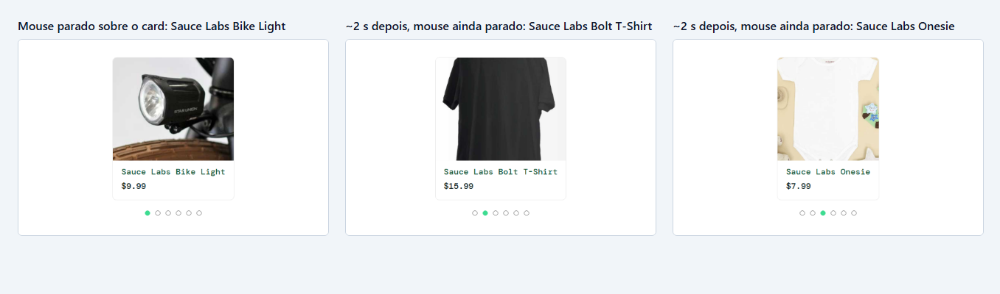

# BUG-17 — Carrossel do "Dynamic Catalog › Slider" troca a cada 2 s e não pode ser pausado

| Campo | Valor |
|---|---|
| **Severidade** | 🟡 Média |
| **Prioridade** | P2 |
| **Tipo** | Acessibilidade e usabilidade · WCAG 2.2 **2.2.2 Pausar, parar, ocultar (nível A)** |
| **Usuário** | `standard_user` |
| **Ambiente** | Chromium (Playwright 1.65), desktop 1280×720 · 2026-11-27 |
| **Reprodutibilidade** | Sempre |
| **Caso / sessão** | [CTM-DIN-04](../casos-de-teste.md#catálogo-dinâmico) · [Sessão S3](../sessoes-exploratorias.md#s3--área-nova-dynamic-catalog) |

## Passos para reproduzir
1. Entrar com `standard_user` → menu → **Dynamic Catalog** → **Slider**.
2. Parar o mouse sobre o card do produto e esperar.
3. Procurar um botão de pausa.

## Resultado esperado
O carrossel pausa com o mouse em cima (ou com foco), e existe um controle para pausar.
O WCAG exige isso para qualquer conteúdo que se move sozinho por mais de 5 segundos.

## Resultado obtido
O produto troca a cada **~2 segundos** (6 trocas medidas: entre 1,94 s e 2,07 s), em ciclo sem fim. Com o mouse
parado sobre o card ele continua trocando. Não há botão de pausa, só os pontos de navegação.

## Impacto
Dois segundos não bastam para ler nome e preço com calma. Para pessoas com TDAH, baixa visão ou que usam
ampliação de tela, o movimento constante atrapalha o resto da página.

## Fora do defeito (verificado e correto)
Clicar num ponto leva ao produto certo (ponto 6 → "Sauce Labs Fleece Jacket").

## Hipótese descartada
Num primeiro print, nome e imagem pareciam de produtos diferentes. Era o print tirado no meio da animação (o
texto troca ~0,5 s antes da imagem). Com a transição terminada eles batem, então **não é defeito**.

## Automação
❌ **Manual.** O comportamento depende de tempo. Pela regra do projeto, defeito dependente de tempo é documentado e
não vira teste, porque um teste que falha ao acaso destrói a confiança na suíte.
