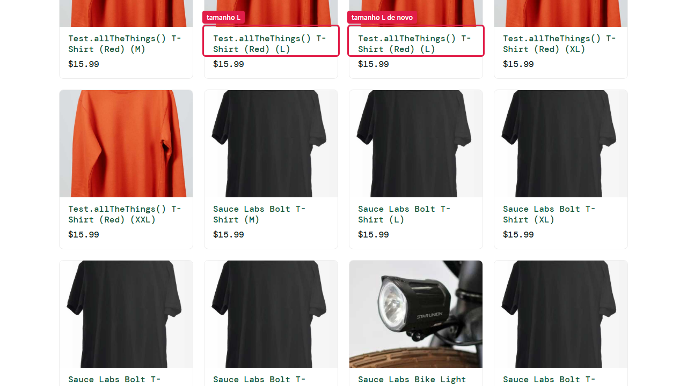

# BUG-18 — "Dynamic Catalog › Lazy Load" lista o tamanho L duas vezes e repete o catálogo sem fim

| Campo | Valor |
|---|---|
| **Severidade** | 🟡 Média |
| **Prioridade** | P3 |
| **Tipo** | Funcional · dados do catálogo |
| **Usuário** | `standard_user` |
| **Ambiente** | Chromium (Playwright 1.65), desktop 1280×720 · 2026-11-27 |
| **Reprodutibilidade** | Sempre (2 de 2 carregamentos, mesma posição) |
| **Caso / sessão** | [CTM-DIN-02](../casos-de-teste.md#catálogo-dinâmico) · [Sessão S3](../sessoes-exploratorias.md#s3--área-nova-dynamic-catalog) |

## Passos para reproduzir
1. Entrar com `standard_user` → menu → **Dynamic Catalog** → **Lazy Load**.
2. Rolar a página até carregar a terceira leva de itens (cerca de 24 cards).
3. Ler os nomes das variações de "Test.allTheThings() T-Shirt (Red)".

## Resultado esperado
Cada combinação de produto e tamanho aparece uma vez, e a lista termina quando acabam os produtos.

## Resultado obtido
1. **Tamanho L duplicado:** a sequência é XS, S, M, **L, L**, XL, XXL.
2. **Ordem inconsistente:** na "Bolt T-Shirt" o tamanho S aparece depois do XXL (XS, M, L, XL, XXL, **S**).
3. **Catálogo em loop:** depois de 22 itens a lista recomeça do primeiro ("Sauce Labs Bike Light") e continua
   repetindo a cada rolagem (48 itens após 6 rolagens, sem fim). O rodapé é empurrado para baixo a cada leva.

## Impacto
O cliente vê o mesmo produto duas vezes e não sabe se são itens diferentes. A repetição infinita dá a impressão
de um catálogo maior do que é, e deixa os links do rodapé inacessíveis.

## Observação para o time
Num catálogo de demonstração, o loop pode ser intencional (para testar rolagem infinita). **O L duplicado não
é:** é dado errado em qualquer interpretação. Por isso a severidade considera o duplicado; o loop fica como
pergunta para o produto.

## Automação
✅ **Candidato** para o L duplicado (contar nomes únicos depois de rolar). O loop depende da decisão de produto.
