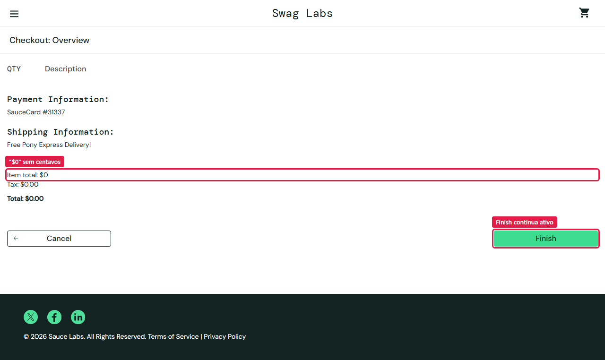

# BUG-19 — "Voltar" depois de concluir o pedido mostra resumo zerado, com "$0" e Finish ativo

| Campo | Valor |
|---|---|
| **Severidade** | 🟢 Baixa |
| **Prioridade** | P3 |
| **Tipo** | Funcional · estado e navegação; conteúdo (formato de moeda) |
| **Usuário** | `standard_user` |
| **Ambiente** | Chromium (Playwright 1.65), desktop 1280×720 · 2026-11-27 |
| **Reprodutibilidade** | Sempre |
| **Caso / sessão** | [CTM-CHK-06](../casos-de-teste.md#checkout) · [Sessão S1](../sessoes-exploratorias.md#s1--checkout-com-dados-no-limite) |
| **Relacionado** | [BUG-09](../../relatorio-de-defeitos.md#bug-09--pedido-concluído-com-carrinho-vazio) (pedido concluído com carrinho vazio) |

## Passos para reproduzir
1. Entrar com `standard_user`, adicionar um produto e concluir a compra até "Thank you for your order!".
2. Apertar o botão **Voltar** do navegador.

## Resultado esperado
Voltar para a página de pedido concluído ou para os produtos. Se o resumo for exibido, ele não deveria permitir
um novo "Finish" sem itens, e os valores deveriam ter o mesmo formato do resto do site.

## Resultado obtido
Volta para "Checkout: Overview" sem itens:
- **"Item total: $0"**, sem centavos, enquanto as linhas de baixo mostram "Tax: $0.00" e "Total: $0.00";
- o botão **Finish** continua ativo. Com o carrinho vazio, ele conclui um pedido vazio (comportamento do BUG-09).

## Impacto
Um cliente que volta para conferir o pedido vê "$0" e pode achar que o pedido foi perdido ou cancelado. Se clicar
em Finish, gera um pedido vazio.

## Automação
✅ **Candidato** de baixa prioridade. A navegação é determinística, e o formato "$0" vs "$0.00" é fácil de verificar.
