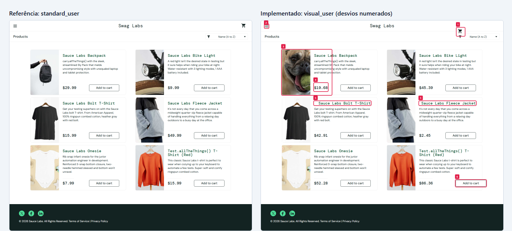
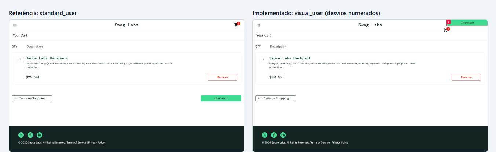

# BUG-20 — Layout do `visual_user` diverge da referência em 7 pontos (FQA visual)

| Campo | Valor |
|---|---|
| **Severidade** | 🟡 Média (o conjunto; o ponto 7 sozinho seria alto se o botão ficasse escondido) |
| **Prioridade** | P2 |
| **Tipo** | Visual · FQA (comparação com a referência) |
| **Usuário** | `visual_user` comparado com o `standard_user` |
| **Ambiente** | Chromium (Playwright 1.65), desktop 1280×720 · 2026-11-27 |
| **Reprodutibilidade** | Sempre (o preço do ponto 4 muda a cada carregamento) |
| **Caso / sessão** | [CTM-VIS-01 e CTM-VIS-02](../casos-de-teste.md#visual) · [Sessão S4](../sessoes-exploratorias.md#s4--fqa-visual-visual_user-vs-referência) |
| **Relacionado** | [BUG-07](../../relatorio-de-defeitos.md#bug-07--preços-diferentes-do-catálogo) (preços diferentes do catálogo) |

## Como a comparação foi feita
O Sauce Demo não tem Figma público. Como em um FQA contra o design, a tela do `standard_user` serve de
**referência aprovada**, e o `visual_user` é a **implementação a validar**. As duas telas foram capturadas no mesmo
tamanho e comparadas lado a lado, elemento por elemento (posição, tamanho, imagem, texto, alinhamento).

## Passos para reproduzir
1. Em uma janela, entrar com `standard_user`. Em outra, com o mesmo tamanho, entrar com `visual_user`.
2. Comparar a página de produtos.
3. Adicionar "Sauce Labs Backpack" nas duas e comparar a página do carrinho.

## Desvios encontrados

| # | Elemento | Referência (`standard_user`) | Implementado (`visual_user`) |
|---|---|---|---|
| 1 | Ícone do carrinho | Canto superior direito (x=1220, y=10) | Deslocado ~190 px para a esquerda, sobre o seletor de ordenação (x=1034, y=39), e girado ~3° |
| 2 | Ícone do menu | Reto | Girado ~3° |
| 3 | Foto da "Sauce Labs Backpack" | Mochila | Foto de um cachorro (arquivo `sl-404…jpg`, imagem de "não encontrado") |
| 4 | Preços | Catálogo ($29.99, $9.99…) | Outros valores, que **mudam a cada carregamento** ($42.7 numa carga, $19.68 na seguinte) e às vezes com uma casa decimal ("$42.7"). Divergência de valor já registrada no BUG-07; o formato e a variação são detalhes novos |
| 5 | Nomes "Bolt T-Shirt" e "Fleece Jacket" | Alinhados à esquerda como os demais | Recuados para a direita |
| 6 | "Add to cart" do último card | Dentro do card, alinhado | Desalinhado, ultrapassando a borda direita do card |
| 7 | Botão "Checkout" (carrinho) | Abaixo da lista, à direita (y=412) | No topo da tela, sobre o cabeçalho (y=0) |

## Impacto
A loja parece quebrada, o que derruba a confiança na hora de pagar. O ponto 3 mostra a foto errada de um produto,
e o ponto 7 tira o botão principal do carrinho do lugar onde o cliente espera encontrá-lo.

## Por que isto não está na automação
O teste visual por screenshot foi deixado **fora do escopo** da suíte E2E de propósito (o site muda e a
renderização varia por sistema operacional). Os pontos 1, 2, 5 e 6 não alteram nenhum texto nem atributo
verificado pelos testes funcionais, então só aparecem para quem olha a tela.

## Automação
⚠️ **Manual**, com uma exceção: o ponto 3 (imagem errada) é verificável pelo `src` da imagem e já é a técnica do
CT-DEF-01. O resto é comparação visual. Para automatizar, o caminho seria comparação de screenshot com baseline
num ambiente fixo, e não asserções de DOM.
