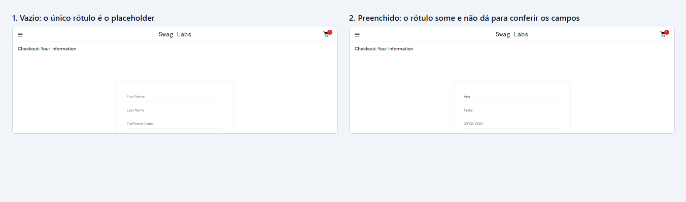

# BUG-21 — Campos do checkout só têm placeholder como rótulo e não têm `autocomplete`

| Campo | Valor |
|---|---|
| **Severidade** | 🟡 Média |
| **Prioridade** | P2 |
| **Tipo** | Acessibilidade e usabilidade · WCAG 2.2 **3.3.2 Rótulos ou instruções (A)** e **1.3.5 Identificar o propósito da entrada (AA)** |
| **Usuário** | `standard_user` |
| **Ambiente** | Chromium (Playwright 1.65), desktop 1280×720 · 2026-11-27 |
| **Reprodutibilidade** | Sempre |
| **Caso / sessão** | [CTM-CHK-04](../casos-de-teste.md#checkout) · [Sessão S2](../sessoes-exploratorias.md#s2--navegação-só-com-teclado) |

## Passos para reproduzir
1. Entrar com `standard_user`, adicionar um produto e ir ao **Checkout**.
2. Preencher os três campos.
3. Tentar identificar qual valor está em qual campo.

## Resultado esperado
Cada campo tem um rótulo que continua visível depois de preenchido, e os atributos `autocomplete="given-name"`,
`"family-name"` e `"postal-code"` permitem que o navegador preencha os dados.

## Resultado obtido
- O único rótulo é o placeholder ("First Name", "Last Name", "Zip/Postal Code"), que **some ao digitar**. Não há
  `<label>` nem `aria-label` nesses campos (o login tem `aria-label`, o checkout não).
- Nenhum campo tem `autocomplete`, então o navegador não oferece o preenchimento automático de nome e CEP.

## Impacto
Quem revisa o formulário antes de continuar (ou volta depois de uma mensagem de erro) não consegue conferir se
"Teste" está no sobrenome. É exatamente o tipo de troca que o [BUG-04](../../relatorio-de-defeitos.md#bug-04--sobrenome-vai-para-o-campo-first-name)
causa no `problem_user`, e esse layout torna mais difícil de perceber. No celular, sem `autocomplete`, a pessoa
precisa digitar tudo.

## Por que a automação não pegou
O axe-core (CT-ACS-01) passa nesta tela porque aceita o placeholder como nome acessível. A regra do axe para
`autocomplete` só verifica se o valor é válido **quando o atributo existe**; ela não acusa a ausência.

## Automação
✅ **Candidato** para o `autocomplete` (verificação de atributo). A visibilidade do rótulo fica no checklist manual.
