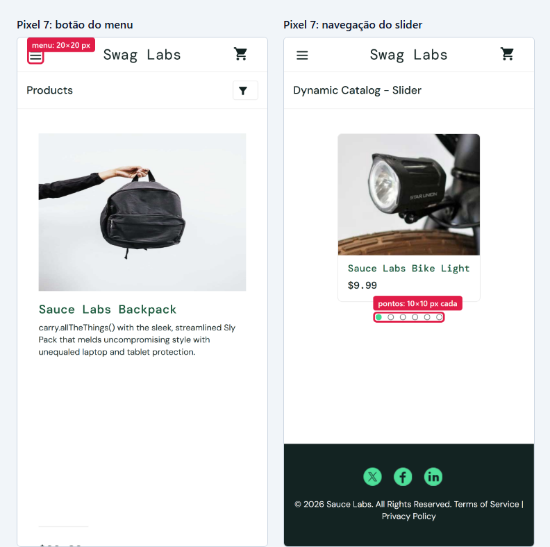

# BUG-23 — Botão do menu (20×20 px) e pontos do slider (10×10 px) são pequenos demais para o toque

| Campo | Valor |
|---|---|
| **Severidade** | 🟢 Baixa |
| **Prioridade** | P3 |
| **Tipo** | Usabilidade mobile e acessibilidade · WCAG 2.2 **2.5.8 Tamanho mínimo do alvo (AA)** |
| **Usuário** | `standard_user` |
| **Ambiente** | Pixel 7 (Chromium) e iPhone 15 (WebKit), emulados no Playwright 1.65 · 2026-11-27 |
| **Reprodutibilidade** | Sempre (medido nos dois aparelhos) |
| **Caso / sessão** | [CTM-MOB-02](../casos-de-teste.md#mobile) · [Sessão S5](../sessoes-exploratorias.md#s5--recibo-em-pdf-e-mobile) |

## Passos para reproduzir
1. Abrir o site num celular (ou no modo de dispositivo do navegador, Pixel 7) e entrar com `standard_user`.
2. Medir a área clicável do botão de menu (☰), no canto superior esquerdo.
3. Abrir **Dynamic Catalog › Slider** e medir os pontos de navegação abaixo do card.

## Resultado esperado
Alvos de toque com pelo menos **24×24 px** (mínimo do WCAG 2.2 AA). O recomendado por Apple e Google é
44–48 px.

## Resultado obtido

| Elemento | Tamanho | Espaço até o vizinho |
|---|---|---|
| Botão do menu (`#react-burger-menu-btn`) | 20×20 px | isolado no canto |
| Cada ponto do slider | 10×10 px | 10 px entre pontos |

## Impacto
O menu é a única forma de fazer logout e de chegar ao Dynamic Catalog. Nos pontos do slider, um dedo
(~10 mm, cerca de 40 px) cobre dois ou três pontos de uma vez, e é fácil tocar no produto errado.

## Observação
O WCAG aceita alvo menor que 24 px se um círculo de 24 px centrado nele não encostar no vizinho. O botão do menu
fica isolado e pode se encaixar nessa exceção (fica como discussão com o time). Os pontos do slider não se encaixam:
os centros estão a 20 px um do outro.

## Automação
✅ **Candidato** de baixa prioridade (medir `boundingBox()` no projeto mobile).
